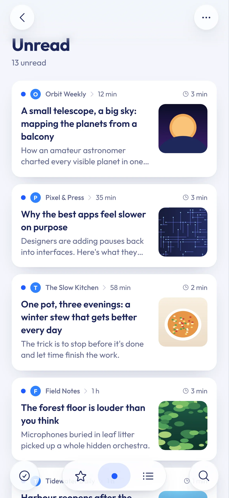
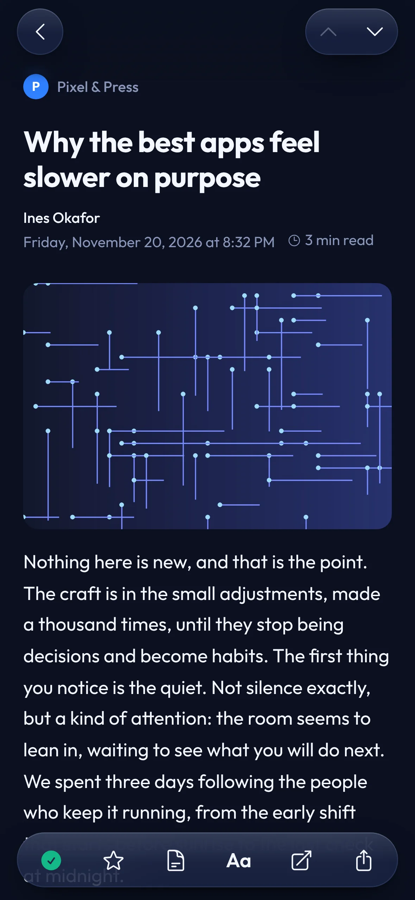

<p align="center">
  
</p>

<h1 align="center">Ebi Furai</h1>

<p align="center">
  A self-hosted RSS reader in the spirit of Reeder Classic.<br>
  Made for iPhone and iPad first, at home on the desktop too.
</p>

<p align="center">
  <a href="https://github.com/trapassati/ebi-furai/actions/workflows/ci.yml"></a>
  <a href="https://github.com/trapassati/ebi-furai/releases/latest"></a>
  <a href="LICENSE"></a>
</p>

<p align="center">
  <a href="https://trapassati.github.io/ebi-furai/"><b>Website</b></a> ·
  <a href="#install">Install</a> ·
  <a href="#configuration">Configuration</a> ·
  <a href="CHANGELOG.md">Changelog</a>
</p>

<p align="center">
  
  
</p>

Ebi Furai is one small server (a single Go binary with SQLite) and an installable web app. You run it on
your own machine: a home server, a Raspberry Pi, a NAS, a VPS. Your feeds, your reading and your accounts
stay there.

The interface is in **English and Italian**, chosen from the device's language.

## Features

- **Reading**: unread, today, starred and all articles; folders; full text of truncated articles with one tap
  (or always, per feed); reading time; pictures full screen with zoom; search across everything you have.
- **Made for touch**: swipe to star or mark as read, pull to refresh, mark as read while scrolling,
  "mark the ones above / below as read", undo for every bulk action.
- **Works offline**: the latest unread articles and the starred ones are kept on the device; what you do
  offline is sent when the connection comes back.
- **Notifications and badge**: a summary of what's unread at the times you choose, with the count on the
  app icon (iOS 16.4 and later, Android, desktop browsers).
- **Tidy feeds**: keyword filters that hide or mark as read ("football", "horoscope*"), duplicates merged
  across feeds (a newspaper and Google News), ad filtering with EasyList, per-feed short names.
- **Feed health**: feeds that stop working are listed with what the error means and what to do.
- **iPad, iPhone Duo and desktop layouts**: two or three columns, side-by-side pages on foldables. On a
  computer it works like a desktop app: commands at the top of each column, a compact list, menus where you
  click, tooltips with the keyboard shortcuts, columns you can resize, interface scale for large screens.
- **Your favourite app too**: Reeder, NetNewsWire and other apps sync through the Google Reader API, with app
  passwords you can revoke one by one.
- **Several users**, each with their own feeds; two-step verification (TOTP) with recovery codes;
  connected devices you can sign out.
- **Safe by default**: argon2id passwords, CSRF tokens, rate-limited sign-in, sanitized HTML, a strict
  Content-Security-Policy, SSRF protection for every outgoing request, images proxied through the server.
- **Automatic backups** of the database, daily, downloadable and restorable from the app, with copies on a WebDAV
  server (Nextcloud, a NAS…) if you like.

## Install

You need a machine that is on most of the time. Pick one of these; neither needs any compiling.

### With Docker (recommended)

Docker Engine with the Compose plugin, on Linux `amd64` or `arm64` (Raspberry Pi 4/5, most NAS).

```sh
mkdir ebi-furai && cd ebi-furai
curl -fsSLO https://raw.githubusercontent.com/trapassati/ebi-furai/main/compose.yaml
docker compose up -d
docker compose logs ebi-furai | grep "setup code"
```

Open `http://SERVER-ADDRESS:9099`, type the setup code from the log and create the administrator.

To change settings, put a `.env` file next to `compose.yaml` (start from
[`.env.example`](.env.example)) and run `docker compose up -d` again.

### As a Linux service (no Docker)

On Debian, Ubuntu, Raspberry Pi OS and other systemd distributions, `amd64` or `arm64`:

```sh
curl -fsSL https://raw.githubusercontent.com/trapassati/ebi-furai/main/scripts/install.sh | sudo sh
journalctl -u ebi-furai | grep "setup code"
```

The script downloads the latest release, checks its checksum and installs:

| What | Where |
| --- | --- |
| Program | `/usr/local/bin/ebi-furai` |
| Settings | `/etc/ebi-furai/ebi-furai.env` |
| Data (database, backups) | `/var/lib/ebi-furai` |
| Service | `ebi-furai.service` (`systemctl status ebi-furai`) |

Run the same command again to update. The binaries are also on the
[releases page](https://github.com/trapassati/ebi-furai/releases), with a systemd unit in each archive.

## Reach it from your phone: HTTPS

On your home network the app works at `http://SERVER-ADDRESS:9099`. To install it on the iPhone's Home Screen,
use it away from home and get notifications, it needs an **https** address. Two common ways:

**Cloudflare Tunnel** (no open ports, free): create a tunnel with a public hostname pointing to
`http://localhost:9099`, then in `.env`:

```sh
BIND_ADDR=127.0.0.1      # only the tunnel reaches the port
TRUST_CF_HEADER=true     # the real client address for the sign-in rate limit
```

Don't put Cloudflare Access in front of it: it breaks the web app manifest and the offline worker.

**A reverse proxy** with your own domain, for example [Caddy](https://caddyserver.com/), which gets the
certificate by itself:

```
rss.example.com {
    reverse_proxy localhost:9099
}
```

Either way the app needs a **stable address**: a web app installed on the Home Screen belongs to its address.

## On iPhone and iPad

1. Open the https address in **Safari** and sign in.
2. Tap Share → **Add to Home Screen**, then open the app from its icon.
3. For notifications: Settings → Notifications → turn on "Notifications on this device".

The app shows these steps itself the first time it's opened in Safari.

## Reeder, NetNewsWire and other apps

Ebi Furai speaks the Google Reader API, the one of FreshRSS, so native apps can show your feeds and keep read and
starred articles in sync with the web app: Reeder, NetNewsWire, ReadKit, FeedMe, Fluent Reader and others.

1. In Ebi Furai: Settings → **Reeder and other apps** → New app password. Each app gets its own password, which
   works with two-step verification on and can be revoked without touching the others.
2. In the app, add a **FreshRSS** account (or "Google Reader API") with:
   - server: `https://YOUR-ADDRESS/api/greader.php`
   - username: your Ebi Furai username
   - password: the app password

Apps see the same articles as the web app (not the ones hidden by filters; duplicates only once) and load the
pictures straight from the sites, not through the image proxy.


Every setting is optional. With Docker they go in `.env`; with the service in
`/etc/ebi-furai/ebi-furai.env` (then `sudo systemctl restart ebi-furai`).

| Variable | Default | |
| --- | --- | --- |
| `BIND_ADDR` | `0.0.0.0` | Docker only: `127.0.0.1` publishes the port to this machine only |
| `PORT` | `9099` | Docker only: the port on the host |
| `LISTEN_ADDR` | `:9099` | where the server listens |
| `COOKIE_SECURE` | `auto` | Secure cookies when the app is opened over https; `true` / `false` to force |
| `TRUST_CF_HEADER` | `false` | trust `CF-Connecting-IP` (only behind Cloudflare Tunnel) |
| `ADMIN_USER`, `ADMIN_PASSWORD` | | create the administrator at first start instead of the setup page |
| `APP_NAME` | `Ebi Furai` | name in the app and under the Home Screen icon |
| `TZ` | system zone | time zone for "Today" and notification times, e.g. `Europe/Rome` |
| `REFRESH_INTERVAL` | `20m` | how often feeds are refreshed (at least `5m`); each user can choose their own |
| `FETCH_WORKERS` | `4` | feeds downloaded at once |
| `RETENTION_DAYS` | `90` | older articles are deleted (starred ones stay) |
| `IMAGE_PROXY` | `true` | article images go through the server |
| `AD_FILTER_LISTS` | EasyList + EasyList Italia | `https://` filter lists, comma separated |
| `VAPID_SUBJECT` | the app's address | contact for the push services (`mailto:` or `https://`) |
| `DATA_DIR` | `/data` (Docker) | database folder |
| `BACKUPS` | `true` | daily backups |
| `BACKUP_KEEP_DAILY`, `BACKUP_KEEP_WEEKLY` | `7`, `4` | how many are kept |
| `BACKUP_DIR` | `DATA_DIR/backups` | where they go |
| `UPDATE_CHECK` | `true` | look for a new release on GitHub twice a day and tell the administrators |
| `SOURCE_URL` | this repository | where the source code is offered (see [License](#license)) |

## Backups and restore

The server saves a compressed copy of the database every day, keeping the last 7 days and 4 weeks. Administrators
see them in **Settings → Backup**, where they can make one now and download it. A backup contains every account
and the feed passwords: keep it somewhere safe, and copy it away from the server now and then.

To keep **copies elsewhere**, in Settings → Backup choose "Copy to a WebDAV server" and give the address of a
folder (Nextcloud: `https://YOUR-CLOUD/remote.php/dav/files/USER/Backups/ebi-furai/`), a username and a password
(an app password, where the server has them). Every backup is copied there and the same days and weeks are kept.
The copies hold every account: use a server you trust. Backups can also be deleted from the list, one by one.

To **restore**, in Settings → Backup tap the restore button next to a backup, or "Restore from a file…" for one
you downloaded (also from another Ebi Furai installation), and confirm with your password. The file is checked
first; then the current database is saved as a new backup (to go back if needed), the server restarts with the
restored one, and every device signs in again. The whole database is replaced: every account, feed and article.

If the app cannot start at all, restore by hand. With Docker (the volume is `ebi-furai_data` when the folder is
`ebi-furai`):

```sh
docker compose down
docker run --rm -v ebi-furai_data:/data -v "$PWD":/backup alpine \
  sh -c 'gunzip -c /backup/ebi-furai-YYYY-MM-DD-hhmmss.db.gz > /data/reader.db && rm -f /data/reader.db-wal /data/reader.db-shm && chown 65532:65532 /data/reader.db'
docker compose up -d
```

With the service: `sudo systemctl stop ebi-furai`, `gunzip -c BACKUP.db.gz | sudo tee /var/lib/ebi-furai/reader.db >/dev/null`,
`sudo chown ebi-furai: /var/lib/ebi-furai/reader.db`, `sudo systemctl start ebi-furai`.

## Updating

- Docker: `docker compose pull && docker compose up -d`
- Service: run the install command again.

Installed apps pick up the new version the next time they are opened. When a new release is out, administrators
see it when they open the app, with what changed and the command for their installation, and get a notification
on the devices where notifications are on (`UPDATE_CHECK=false` turns this off: then the server never contacts
GitHub).

## Locked out?

If someone loses both the phone and the recovery codes of two-step verification, an administrator turns it off
from their user menu. For the administrator account itself:

```sh
docker compose exec ebi-furai /ebi-furai reset-2fa USERNAME      # Docker
sudo -u ebi-furai env DATA_DIR=/var/lib/ebi-furai /usr/local/bin/ebi-furai reset-2fa USERNAME   # service
```

## Keyboard shortcuts

`J`/`K` next/previous · `M` read/unread · `S` star · `F` full text · `V` open the original · `Shift`+`A` mark all
as read · `/` search · `R` refresh · `1`–`4` collections · `B` show/hide the column · `Esc` back · `?` all shortcuts

## Building from source

Go (the latest stable release) and a POSIX shell:

```sh
git clone https://github.com/trapassati/ebi-furai && cd ebi-furai
scripts/fetch-gsap.sh            # GSAP is downloaded, see "License"
go build -o ebi-furai ./cmd/ebi-furai
DATA_DIR=./data ./ebi-furai
```

Or build the image yourself: `docker compose -f compose.yaml -f compose.build.yaml up -d --build`.
See [CONTRIBUTING.md](CONTRIBUTING.md) for the tests and the layout of the code.

## License

Copyright © 2026 Fartingloud.

Ebi Furai is free software under the **GNU Affero General Public License v3.0** ([LICENSE](LICENSE)). You may use,
study, change and share it, also commercially. If you run a modified version for other people, even only as an
online service, you must offer them its source code under the same license: set `SOURCE_URL` to where you
publish it, and the app links to it from Settings → About.

The animations use [GSAP](https://gsap.com/), which is free to use but not open source (Webflow's Standard
"No Charge" License). It is not kept in this repository: the build downloads it from npm. [NOTICE](NOTICE)
grants the additional permission, under section 7 of the AGPL, to distribute Ebi Furai together with GSAP.

Other components: Lenis, uqr, Heroicons and Tailwind CSS (MIT); the Outfit and M PLUS Rounded 1c fonts (SIL Open
Font License 1.1); EasyList and EasyList Italia (GPL-3.0 or CC BY-SA 3.0, downloaded by the server, not included);
the Go modules listed in Settings → About, whose license files ship in `/licenses` in the Docker image and in the
release archives. The shrimp and koi illustrations are by Fartingloud and part of this project.
